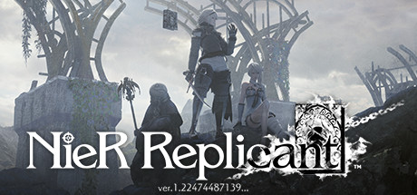

**NieR Replicant ver.**

---

## 📖 About

NieR Replicant ver.1.22474487139... by Square Enix (2021) is the remaster of the original NieR, which was a Japan-only prequel to NieR:Automata. You play as a young man seeking a cure for his sister Yonah's Black Scrawl disease. Completing all five endings requires playing through the story multiple times, each pass revealing deeper truths.

## ⚠️ Problems Without Trainer

| Problem | Status |
|---------|--------|
| Fourth playthrough erases all save data as part of the narrative permanently | ✅ Solved |
| Weapon upgrade materials require extensive fishing and gathering mini-games | ✅ Solved |
| High score combo challenges in combat arenas demand rapid attack memorization | ✅ Solved |
| Post-game DLC boss fights exceed normal stat levels by enormous margins | ✅ Solved |
| Rare drop rates for weapon story unlocks require dozens of farming attempts | ✅ Solved |

## ✅ Solution

The **NieR Replicant Trainer** solves all these issues, giving you complete control so you can focus on enjoying the game.

## 🎯 Features

- Unlimited Resources / Currency
- God Mode / Invincibility
- Instant Skill & Ability Cooldown
- One-Hit Kill
- Freeze Timers
- Unlock All Items & Achievements
- Custom Speed Multiplier
- Infinite Stamina / Energy

## 🚀 Quick Start

1. **Disable Windows Defender** temporarily (trainer may trigger false positive)
2. Get the trainer from the button above
3. Launch NieR Replicant
4. Run the trainer as Administrator
5. Use the hotkeys to activate cheats in-game

## 💎 Free vs Pro

| Feature | Free | Pro |
|---------|------|-----|
| God Mode | ✅ | ✅ |
| Unlimited Resources | ✅ | ✅ |
| Advanced Cheats | ❌ | ✅ |
| Auto-Updates | ❌ | ✅ |
| Priority Support | ❌ | ✅ |

## 💻 Requirements

- Windows 10 / 11 (64-bit)
- NieR Replicant (any version)
- .NET Framework 4.8+
- DirectX 11+

## 🍎 macOS

## ⚖️ Legal

Educational and single-player use only.

---

